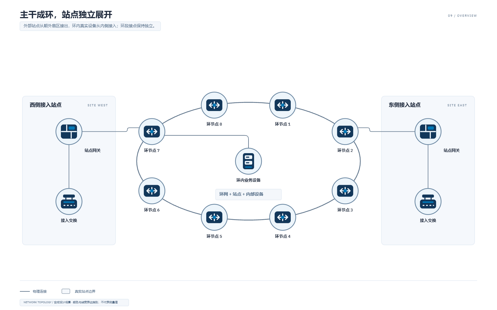

# Render Network Topology

面向不同 agent 和用户的通用网络拓扑技能。生成自包含的离线 HTML，包含矢量图标、深浅主题、布局编辑和 SVG／PNG／JSON 导出，无需联网或安装依赖包。



## 直接使用

下载并解压整个技能文件夹，在能读取技能的 agent 中使用 `SKILL.md`。也可以在终端独立运行；不依赖特定宿主或本机目录。V2 构建需要 Node.js；旧模型渲染需要 Python 3.10+。命令均从技能根目录执行。

```sh
node tools/build_topology_v2_design.js --output outputs/samples
node tools/build_topology_v2_design.js --model examples/v2-minimal.json --output outputs/my-topology
```

打开输出目录中的 `index.html`。文件包含全部资源，可以复制到其他电脑离线打开。可选地将此文件夹放入 agent 自己的技能目录；Codex 的界面信息在 `agents/openai.yaml`，其他 agent 可直接读取 `SKILL.md`。

## 能力

- 八类构图：分层、中心辐射、双中心、环网、网格、嵌套区域、泳道、无连线能力图；允许组合环网、站点、区域和设备。
- 连线分别表达物理、逻辑、管理、主备与故障，支持圆角折线、直线、曲线、管道、多色业务和数据包示意。
- 六套图标配色：海洋蓝、青绿、紫罗兰、暖铜、石墨灰、分类多彩。整图选择默认配色；编辑时可为选中设备单独指定或恢复继承。深浅主题均适配。
- 离线编辑位置、标签、区域、环网、接点及线路控制点；轻量吸附、锁定、撤销和重做；HTML 保存、完整模型保存与验证导入。
- 设备对齐以圆盘为准，不受下方文字长度影响。环段共用同一椭圆骨架，外接支线拥有独立接点。

默认静态。业务动画是示意，颜色、宽度和数据包数量不代表实测。编辑器调整布局与配色；增删真实设备和链路需要修改 JSON。样板的坐标经过人工安排，不宣称提供通用自动布局。

## 模型、规范与验证

[V2 格式与编辑](references/topology-v2-design.md) · [图标及配色](references/icon-catalog.md) · [通用设计规范](references/topology-design-standard.md) · [技能入口](SKILL.md)

```sh
node tools/verify_topology_v2_ring.js
node tools/verify_topology_v2_editor.js
node tools/verify_topology_v2_snapping.js
node tools/verify_topology_v2_palettes.js
node tools/verify_topology_v2_standard.js
python tools/verify_generic_package.py
```

先按默认路径构建样板（`node tools/build_topology_v2_design.js`），再运行检查。浏览器检查脚本另需已安装的 `agent-browser` 与可用 Chromium；不属于生成或使用 HTML 的依赖。

旧 Python 模型继续支持全局配色、布局编辑和导出：

```sh
python scripts/render_topology.py examples/network-topology.json --output outputs/legacy.html
```

## 许可

保留现有[技能许可](LICENSE)：允许使用、修改、免费分享、商业拓扑成品交付与收费在线服务；禁止未经授权对修改版技能软件收费分发。具体范围以许可全文为准。IBM Plex Sans 单独遵循 [SIL OFL 1.1](assets/fonts/IBMPlexSans-LICENSE.txt)。

本地版本 2.1.0 为通用化和配色修订版；变更见 [CHANGELOG.md](CHANGELOG.md)。
