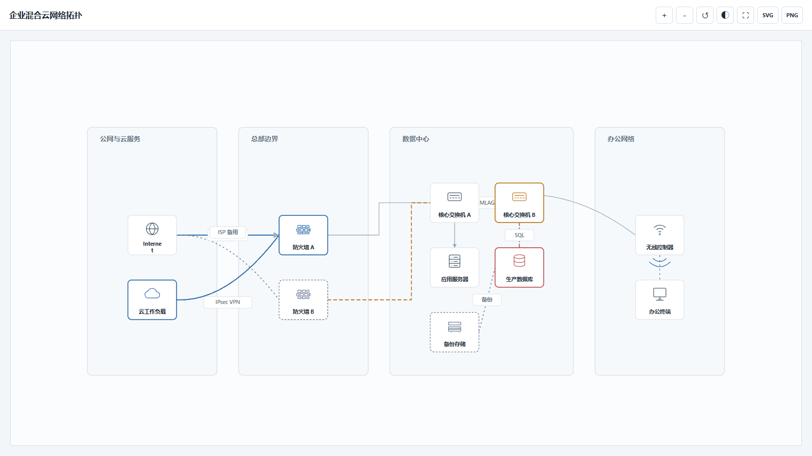
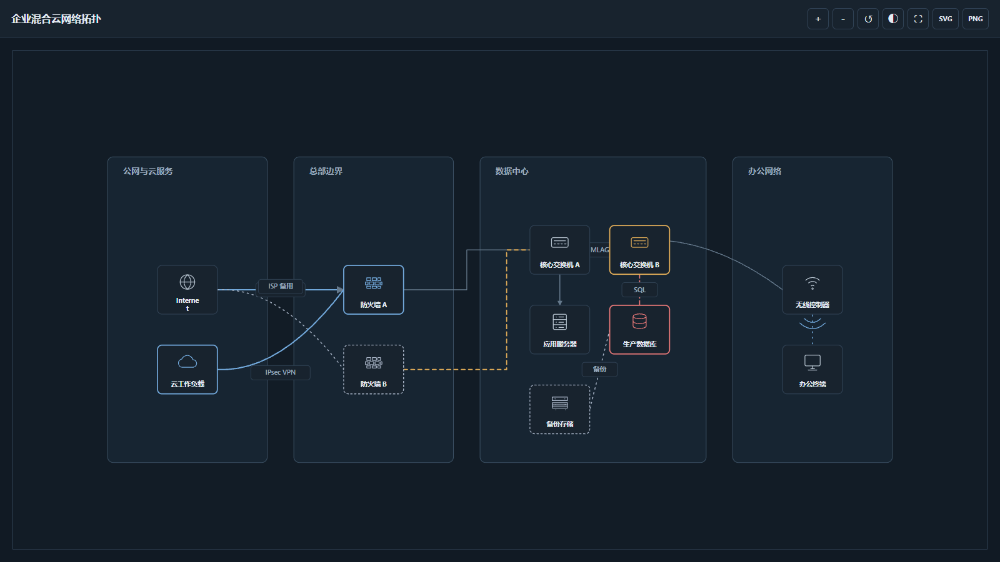

# Render Network Topology

将文字描述、手绘草图、截图或既有拓扑 HTML 转换为专业、扁平化、离线可打开的网络拓扑图。输出为单文件 HTML，内嵌 SVG、图标、样式和结构化拓扑模型。

## 功能

- 支持网络设备、服务器、存储、云、终端、安全和无线设备图标
- Azure-inspired 的克制企业风格，支持浅色/深色主题
- 直线、折线、曲线和静态无线连接
- 分组区域、状态高亮、HA/冗余链路和标签
- 编辑模式：移动节点/区域、调整线路、移动标签
- 线路端点支持 8 个 45°连接点
- HTML/SVG/PNG 导出，以及 JSON 模型保存
- 无 CDN、无第三方 Python 依赖，可离线打开
- 借鉴 diagram-design 的编辑化约束：层级阅读顺序、克制焦点、lane-aware 圆角正交线路、标签留白和 SVG 可访问性元数据

## 示例

以下示例由本技能生成，展示同一混合云网络在浅色与深色主题下的效果。

| 浅色主题 | 深色主题 |
| --- | --- |
|  |  |

## 安装为 Codex Skill

### Windows PowerShell

```powershell
git clone https://github.com/Peytonlukm/render-network-topology-skill.git `
  "$env:USERPROFILE\.codex\skills\render-network-topology"
```

### macOS/Linux

```bash
git clone https://github.com/Peytonlukm/render-network-topology-skill.git \
  ~/.codex/skills/render-network-topology
```

安装后重新打开 Codex，使其发现新 skill。

## 调用方式

在 Codex 中直接描述需求即可，例如：

```text
根据这张网络草图生成拓扑图，使用浅色 Azure-inspired 风格，线路采用水平/垂直折线，突出防火墙 HA 链路。
```

也可以明确调用：

```text
$render-network-topology
```

Skill 会先确认主题、画布、分组、连接方式和高亮要求，再生成：

```text
outputs/<name>.html
```

## 直接渲染 JSON

需要 Python 3.9+，不需要安装依赖：

```powershell
python scripts/render_topology.py model.json --output outputs/network-topology.html
```

最小模型结构：

```json
{
  "title": "Example Topology",
  "canvas": {
    "theme": "light",
    "layout": "enterprise",
    "editable": true,
    "visual_profile": "enterprise-orderly-plus",
    "routing": "lane-aware"
  },
  "groups": [],
  "nodes": [
    {"id": "fw", "label": "FW", "type": "firewall"},
    {"id": "core", "label": "CORE", "type": "core-switch"}
  ],
  "edges": [
    {"id": "fw-core", "source": "fw", "target": "core", "style": "straight"}
  ]
}
```

完整字段和设备类型见 [`references/topology-model.md`](references/topology-model.md) 与 [`references/icon-catalog.md`](references/icon-catalog.md)。

视觉规范补充见 [`references/diagram-design-alignment.md`](references/diagram-design-alignment.md)，其中定义了 detail、audience、destination 三个可选设计拨杆。

## 编辑与保存

打开生成的 HTML 后点击 `Edit`：

- 拖动节点和区域调整布局
- 选中线路后拖动路由点或 8 个端点锚点
- 使用 `HTML` 下载编辑后的完整 HTML
- 使用 `JSON` 下载结构化模型，便于后续重绘或交给其他 agent

浏览器出于安全限制会下载新文件，不会静默覆盖原始 HTML。

## 目录

- `SKILL.md`：Codex 调用规则和绘图流程
- `scripts/render_topology.py`：确定性 HTML/SVG 渲染器
- `assets/device-icons.svg`：内置中性设备图标
- `references/`：模型、图标和视觉规范
